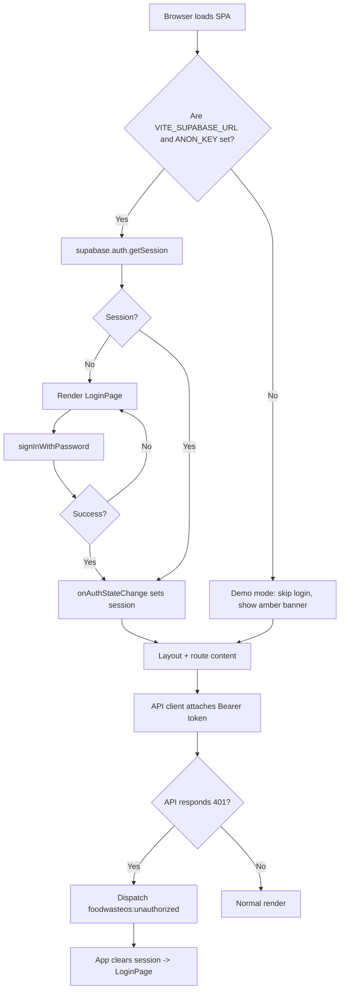
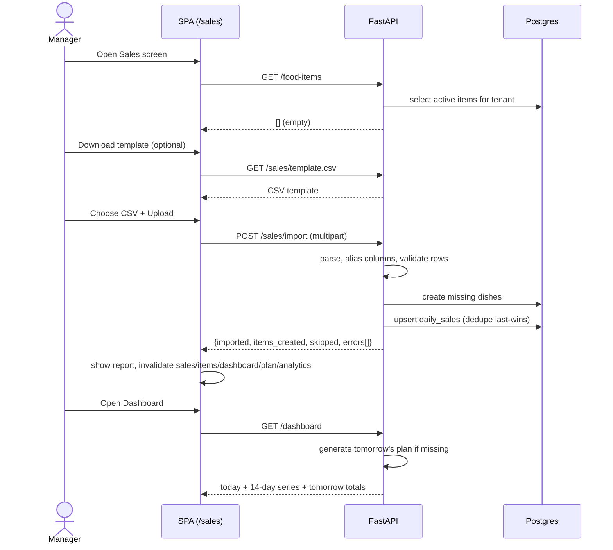
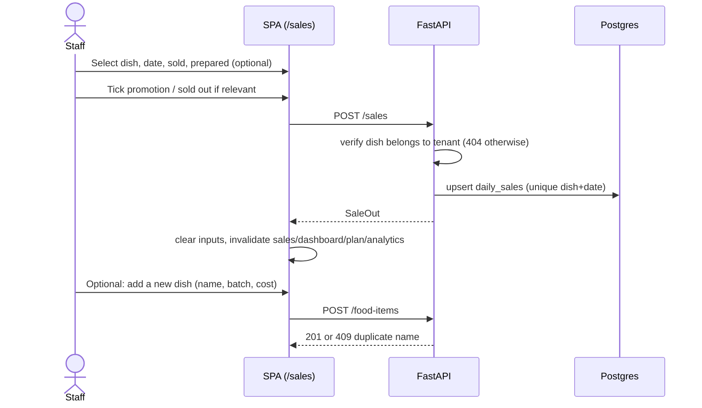
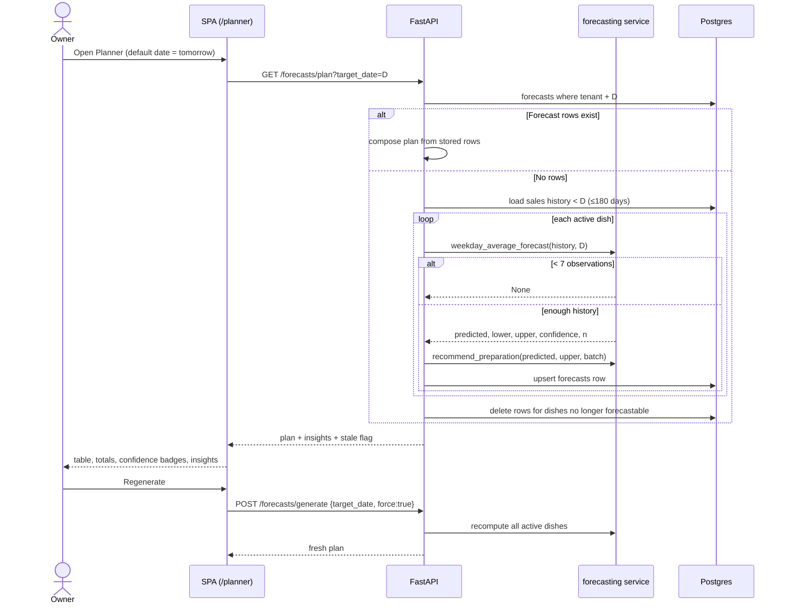
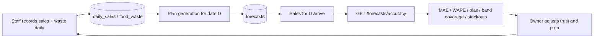

# FoodWasteOS — Application Flow

How a user moves through the product, what the system does at each step, and how failures are
handled. Screens are described in [04-frontend-guidelines.md](04-frontend-guidelines.md); the
underlying services are in [05-backend-structure.md](05-backend-structure.md).

---

## 1. Actors and entry points

| Actor | Enters via | Can do |
|---|---|---|
| Owner / manager | Supabase login → SPA | Everything: catalogue, import, entry, plan generation, analytics |
| Staff | Supabase login → SPA | Sales and waste entry, read plans/dashboard |
| Demo user | No login (Supabase env unset) | Everything as demo owner, against seeded sample data |
| Scheduler (future) | `POST /api/v1/forecasts/generate` | Generate plans nightly |

Routes:

| Path | Screen | Guard |
|---|---|---|
| `/login` | Login (rendered by `App` when Supabase is configured and no session) | none |
| `/` | Dashboard | session (or demo mode) |
| `/planner` | Preparation plan | session (or demo mode) |
| `/sales` | Sales & waste entry, catalogue, recent sales | session (or demo mode) |
| `/analytics` | Waste and accuracy analytics | session (or demo mode) |
| `*` | Redirect to `/` | — |

There is no sign-up or password-reset screen in v0; accounts are provisioned during onboarding.
A sign-out control lives in the sidebar and mobile header, and an expired session returns the user to
login with an explanatory notice.

---

## 2. Boot and authentication flow

Backend resolution:

1. `AUTH_MODE=dev` → every request resolves to the demo tenant (`demo@foodwasteos.local`,
   `Spice Route Kitchen`). The app refuses to start with dev auth in `staging`/`production`.
2. `AUTH_MODE=supabase` → verify JWT (JWKS ES256/RS256, or HS256 secret for legacy projects),
   `aud` and `exp`; then look up the app `users` row by `sub`.
3. No token → 401. Valid token but no provisioned profile → 403.
4. Every subsequent query is scoped by `restaurant_id` from that profile.

Demo mode contract: the **frontend** decides to skip login when Supabase env vars are missing; the
**backend** must be running `AUTH_MODE=dev`. Mixing one without the other produces a banner with 401s,
which is visible rather than silent.

---

## 3. Flow A — First-time onboarding and historical import

Goal: get from zero data to a usable plan.

Rules the user experiences:

- A 90-day file with a few bad rows still imports the good ones. Bad rows are listed by spreadsheet
  row number (header = row 1).
- Header names are forgiving; required semantics are date, dish, quantity sold.
- Unknown dishes appear in `items_created` with batch size 1, so they are immediately plannable after
  7 days of history.
- Uploading the same file again is safe; it updates instead of duplicating.
- Max file size 5 MB (`MAX_CSV_BYTES`), role owner/manager only.

Failure states:

| Condition | User sees |
|---|---|
| Empty file / unparseable CSV | 400 "empty file" or "could not parse CSV" |
| Missing required columns | 400 listing missing columns |
| File > 5 MB | 413 |
| Some rows invalid | Success banner with "N skipped" and row errors |
| Staff role | 403 "requires role: owner, manager" |

---

## 4. Flow B — Daily manual entry

Notes:

- Re-saving the same dish/date updates the row (no duplicates) — useful for corrections.
- `prepared_quantity` is optional; the UI surfaces it because it is required for true waste-rate
  analysis and stockout interpretation.
- The "sold out" flag matters: it tells the system that sales understate demand.
- Waste entry is a separate form on the Sales screen (dish, date, quantity, reason, notes), with a
  recent-waste list beside recent sales. Saving invalidates dashboard, analytics, plan and accuracy.
- Catalogue changes are owner/manager only; a staff member will see 403 on dish creation.

---

## 5. Flow C — Viewing the preparation plan (core journey)

What the owner decides from the screen:

- **Prepare** quantity per dish (already clamped and batch-rounded).
- **Confidence** per dish: high/medium/low; low items are explicitly "a starting point".
- **Typical range** (lower–upper) to judge risk.
- **Last week** number as a sanity check.
- **What changed**: total prep, demand vs a usual weekday, count of low-confidence and
  collecting-data dishes.

Edge cases:

| Situation | Behaviour |
|---|---|
| New dish, < 7 observations | Row present with `status=collecting_data`, `observations=n`, no fake numbers |
| Dish has 7–27 observations | Number produced, confidence likely `low` (needs ≥14 for medium/high) |
| Recent stockout in the dish's history | Confidence capped at `low` |
| Plan older than `PLAN_STALE_HOURS` (default 36 h) | `stale: true`; UI says regenerate |
| Plan generation throws | Router returns 500; dashboard catches and renders without tomorrow's card |
| Dish deactivated | Dropped from plan on next regeneration |
| Date in the past | Allowed; history used is strictly before that date |

Plan reads can write: `GET /forecasts/plan` materialises rows if none exist. This is intentional so
the first open of the day is fast for everyone else, but it means a GET has a side effect.

---

## 6. Flow D — Dashboard

1. SPA requests `GET /dashboard` (query key `["dashboard"]`).
2. API resolves "today" in the restaurant's timezone.
3. It aggregates the last 14 days of sales and waste, computes today's waste rate and cost, then
   attempts to materialise tomorrow's plan (wrapped in try/except).
4. UI shows four stat cards, a 14-day composed chart, and a dark "tomorrow" card linking to the planner.
5. If every series point is zero, an empty state replaces the page with an "Add sales data" CTA.

Dashboard is one call by design: the owner's first screen must not fan out to five endpoints.

---

## 7. Flow E — Analytics and the feedback loop

Analytics screen:

- Range selector 7d / 30d / 90d drives both `analytics/summary` and `forecasts/accuracy`.
- Accuracy window queries forecasts whose `target_date` is in `[today − days, today)` and joins the
  actual sale row for that dish and date.
- If no forecasts have reached their target date yet, the screen explains that plans become
  comparable only after tomorrow happens — it does not render fake zeros.
- Stockout days are counted as distinct dates in the window with any `stockout=true` row.

The loop is the product promise: every day of data must make tomorrow's plan better or at least
measurable.

---

## 8. Cross-cutting states

| State | Where | Behaviour |
|---|---|---|
| Loading | All screens | Pulse skeleton blocks sized like final content |
| Error | All screens | Rose `ErrorNotice` with API detail; retry by refetch (React Query, 1 retry) |
| Empty (no sales) | Dashboard, Sales, Planner | Explanatory copy + CTA; planner still lists dishes as collecting data |
| Unauthorized (401) | API client | Global event → session cleared → login |
| Demo mode | Layout | Amber banner, desktop and mobile variants |
| Stale plan | Planner | Inline "plan is stale, regenerate" hint |
| Unknown/missing cost | Dashboard, Analytics | Em dash + "add dish costs" hint, never `₹0` |

## 9. Navigation model

- **Desktop (≥ md):** persistent left sidebar (brand, 4 nav items, restaurant footer).
- **Mobile (< md):** sticky top header with brand/date and demo banner, fixed bottom tab bar.
- Content is capped at `max-w-6xl`, with bottom padding on mobile so the tab bar never covers content.

## 10. Sequence summary (happy path, day 1 → day 8)

| Day | User action | System effect |
|---|---|---|
| 1 | Upload 60 days of CSV | Dishes created, sales upserted, import report shown |
| 1 | Open planner | Plan generated for tomorrow; all dishes forecast (≥7 obs) |
| 2 | Enter yesterday's actuals | Sales row upserted; queries invalidated |
| 7 | Open analytics | Accuracy appears for plans whose date has passed |
| 8 | View planner | Confidence reflects measured dispersion from the larger sample |
| ongoing | Correct a number | Same row updated; plan regenerated on next explicit refresh |
