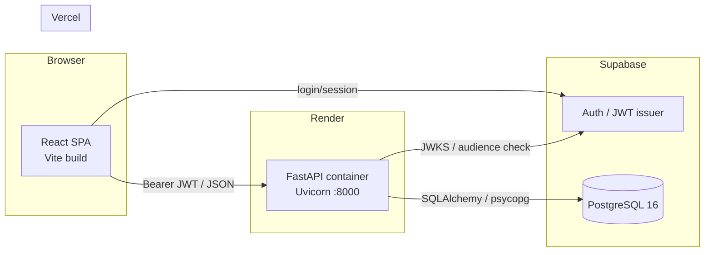

# FoodWasteOS — Tech Stack

Direct dependencies only, as pinned in the repository. Version ranges are declared in
[backend/requirements.txt](../../backend/requirements.txt),
[backend/requirements-dev.txt](../../backend/requirements-dev.txt) and
[frontend/package.json](../../frontend/package.json).

---

## 1. At a glance

| Layer | Technology | Declared version |
|---|---|---|
| Web UI | React 18 + TypeScript 5 + Vite 5 | `react ^18.3.1`, `typescript ^5.6.3`, `vite ^5.4.8` |
| Routing | React Router DOM | `^6.26.2` |
| Server state | TanStack React Query | `^5.59.0` |
| Charts | Recharts | `^2.12.7` |
| Styling | Tailwind CSS 3 + PostCSS + Autoprefixer | `tailwindcss ^3.4.13` |
| Auth client | Supabase JS | `@supabase/supabase-js ^2.45.4` |
| API | FastAPI + Uvicorn | `fastapi >=0.115,<1.0`, `uvicorn[standard] >=0.30` |
| ORM / DB driver | SQLAlchemy 2 (sync) + psycopg 3 | `sqlalchemy >=2.0.30,<2.2`, `psycopg[binary] >=3.2` |
| Validation | Pydantic 2 + pydantic-settings | `pydantic >=2.8,<3.0`, `pydantic-settings >=2.4` |
| Auth verification | PyJWT with crypto extras | `PyJWT[crypto] >=2.9` |
| File uploads | python-multipart | `>=0.0.9` |
| Data / ML | pandas, NumPy, scikit-learn, joblib | `>=2.2`, `>=1.26`, `>=1.5`, `>=1.4` |
| Tests | pytest + httpx (FastAPI TestClient) | `pytest >=8.2`, `httpx >=0.27` |
| Runtime | Python 3.12, Node 22 | `python:3.12-slim`, `node:22-alpine` |
| Database | PostgreSQL 16 (Supabase in prod) | `postgres:16-alpine` |
| Dev orchestration | Docker Compose | spec (no version pin) |

There is no frontend test runner, linter or formatter. CI (GitHub Actions) runs the backend pytest
suite plus `tsc --noEmit` and `vite build`.

---

## 2. Why these choices

### Backend

| Choice | Rationale | Cost / trade-off |
|---|---|---|
| **FastAPI** | Typed request/response contracts via Pydantic, auto OpenAPI at `/docs`, sync routes handled in a threadpool | Threadpool limits heavy concurrency; fine for one outlet |
| **Modular monolith** | One deployable, shared transactions and sessions; ML is in-process | No independent scaling of API vs ML until extraction |
| **Synchronous SQLAlchemy 2.0** | Simple, debuggable; explicit sessions and commits; mature ecosystem | Blocking I/O; scale by more instances or a worker |
| **psycopg 3** | Modern Postgres driver, binary wheels | Not asyncpg; not needed with sync ORM |
| **Supabase (Postgres + Auth)** | Managed backups, hosted JWT issuer, email/password out of the box; ORM connects directly | Vendor coupling; JWT verification path is Supabase-specific |
| **pandas / NumPy** | Idempotent CSV parsing and vectorised history math | Heavy dependency for small data; acceptable at MVP |
| **scikit-learn** | Random Forest challenger and metrics without a platform | Model stays per-tenant, no feature store |
| **pytest + TestClient** | API tests with in-memory SQLite and dependency override | SQLite is not Postgres; catching dialect drift requires staging tests |

### Frontend

| Choice | Rationale | Cost / trade-off |
|---|---|---|
| **Vite + React + TS** | Fast dev server, typed props and API contracts | No SSR; fine for an authenticated SPA |
| **React Query** | Server state, caching, invalidation, request dedupe without Redux | Cache keys must be managed deliberately |
| **React Router** | Standard client routing with a shared layout | Auth guard is a render-level check, not a router loader |
| **Tailwind** | Design tokens and consistent spacing directly in markup | Class-heavy JSX; shared primitives mitigate |
| **Recharts** | Declarative charts for two composed charts | Larger bundle; acceptable for four screens |
| **Supabase JS** | Session storage and token refresh handled client-side | Token retrieval is async on each request |

---

## 3. Runtime topology

Local Docker Compose runs the same three pieces plus a Vite dev server:

| Service | Image / build | Port |
|---|---|---|
| `db` | `postgres:16-alpine`, schema mounted as init SQL | 5432 |
| `api` | `backend/Dockerfile` (python:3.12-slim) | 8000 |
| `web` | `node:22-alpine` running `npm run dev` | 5173 |

---

## 4. Development tooling

| Task | Command | Working dir |
|---|---|---|
| Full stack | `docker compose up --build` | repo root |
| API dev server | `uvicorn app.main:app --reload --port 8000` | `backend/` |
| Backend tests | `python -m pytest -q` | `backend/` |
| Frontend dev server | `npm run dev` | `frontend/` |
| Type check | `npm run typecheck` | `frontend/` |
| Production build | `npm run build` | `frontend/` |
| Preview build | `npm run preview` | `frontend/` |

Local frontend → API: Vite proxies `/api` to `http://localhost:8000` (override with
`VITE_PROXY_TARGET`), so leaving `VITE_API_URL` empty works in development. In production, set
`VITE_API_URL` to the API origin.

---

## 5. Configuration surface

All backend config is environment-driven through
[backend/app/core/config.py](../../backend/app/core/config.py); no secrets in code.

| Variable | Default | Purpose |
|---|---|---|
| `APP_ENV` | `development` | `development` \| `test` \| `staging` \| `production`; gates dev schema/seed |
| `AUTH_MODE` | `supabase` | `dev` (demo tenant) or `supabase` (verify JWTs); dev is rejected in staging/prod |
| `DATABASE_URL` | local Postgres URL | SQLAlchemy URL; SQLite accepted for demo/tests |
| `ALLOWED_ORIGINS` | `http://localhost:5173` | Comma-separated CORS origins |
| `SEED_DEMO_DATA` | `false` | Seed demo tenant on startup (development only) |
| `SUPABASE_URL` | unset | JWKS discovery base |
| `SUPABASE_JWT_AUD` | `authenticated` | JWT audience |
| `SUPABASE_JWT_SECRET` | unset | Legacy HS256 projects only; empty means JWKS |
| `FORECAST_SERVICE_LEVEL` | `0.85` | Band width target |
| `FORECAST_HISTORY_DAYS` | `180` | Generation lookback |
| `FORECAST_MIN_OBSERVATIONS` | `7` | Cold-start cutoff |
| `PLAN_STALE_HOURS` | `36` | Age after which a stored plan is flagged stale |
| `ML_ARTIFACT_DIR` | `./artifacts` | Model artifact directory (registry not yet wired) |
| `MAX_CSV_BYTES` | `5000000` | Upload limit |
| `CRON_SECRET` | unset | Shared secret for `POST /cron/generate`; empty disables the endpoint |

Frontend (build-time, Vite):

| Variable | Purpose |
|---|---|
| `VITE_API_URL` | API origin; empty means same-origin/relative (dev proxy) |
| `VITE_SUPABASE_URL` | Supabase project URL; presence enables login mode |
| `VITE_SUPABASE_ANON_KEY` | Public anon key; presence enables login mode |
| `VITE_PROXY_TARGET` | Dev-server proxy target, default `http://localhost:8000` |

---

## 6. Data and interface conventions

- JSON, `snake_case` fields, ISO-8601 dates (`YYYY-MM-DD`).
- Quantities are integers for sales and numbers for waste/forecasts; money is stored as `numeric`
  and serialised as JSON numbers.
- Errors use FastAPI's `{"detail": ...}` shape; list endpoints are tenant-scoped.
- UTC timestamps in storage; restaurant timezone only for resolving "today"/"tomorrow".
- Database identifiers are UUIDs generated in the database (`gen_random_uuid()`), with ORM-side
  defaults for SQLite compatibility.
- Schema is applied from [supabase/schema.sql](../../supabase/schema.sql); Alembic is deferred until
  the first pilot schema change.

## 7. Deliberate omissions

| Not used | Why |
|---|---|
| Redis / Celery / RQ | Per-tenant forecasting is sub-second at MVP scale |
| Alembic | One canonical `schema.sql`; introduce on first pilot migration |
| Pydantic v1 | v2 is required by FastAPI/pydantic-settings |
| Server-side rendering | The app is authenticated and data-heavy; no SEO need |
| State library (Redux/Zustand) | React Query holds server state; local state is component-scoped |
| OpenAPI client generation | Hand-written `api.ts` is small and typed |
| Frontend unit tests | Covered indirectly by backend contract tests; add when UI logic grows |
