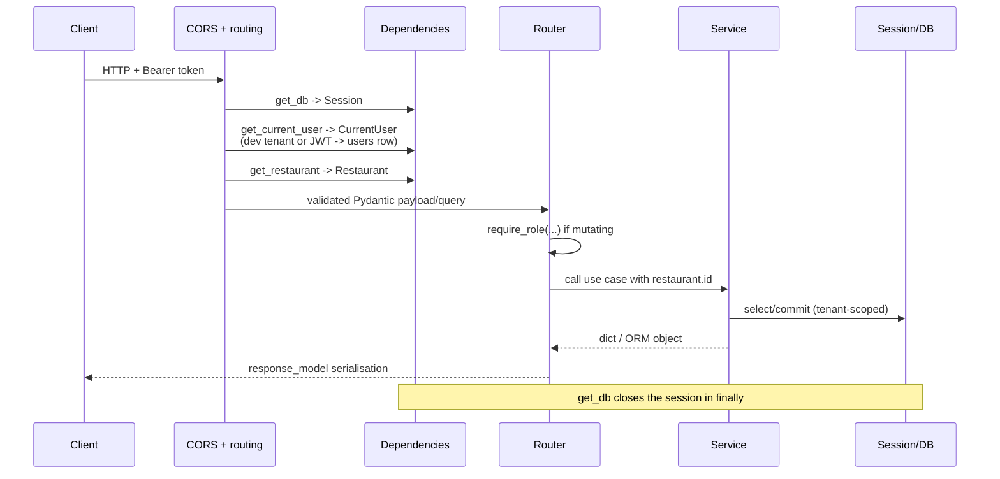

# FoodWasteOS — Backend Structure

How the FastAPI service is organised, which layer owns what, and the patterns to follow when adding
endpoints or services. The database is covered in [06-database-schema.md](06-database-schema.md);
the ML internals in [07-architecture.md](07-architecture.md).

---

## 1. Layering rule

```
api/v1  →  services  →  (ml | db)
```

- **Routers** validate input, resolve identity/tenant, call one service, and return. No SQL, no
  pandas, no business rules.
- **Services** implement use cases (CSV import, plan generation, analytics) and own transactions.
  They never import FastAPI response models. Services may raise `HTTPException` for not-found and
  conflict cases (a deliberate pragmatic choice in this codebase).
- **ML** is pure functions and small classes over DataFrames; it never touches HTTP or the ORM.
- **Schemas** are Pydantic contracts; they can be imported by routers but not by ML.

This keeps the forecast engine testable without a server and lets a future worker reuse `services/`
and `ml/` unchanged.

---

## 2. Module map

```
backend/
├── app/
│   ├── main.py                  # app factory, CORS, lifespan (create_all + seed in dev), /health, /
│   ├── api/
│   │   ├── deps.py              # get_current_user, get_restaurant, bearer scheme
│   │   └── v1/
│   │       ├── router.py        # aggregates all routers under /api/v1
│   │       ├── meta.py          # GET /me
│   │       ├── items.py         # food-items list/create/patch
│   │       ├── sales.py         # sales list/upsert/import/template
│   │       ├── waste.py         # waste list/create
│   │       ├── forecasts.py     # plan/generate/accuracy
│   │       ├── cron.py          # scheduled generation, X-Cron-Secret auth
│   │       └── analytics.py     # dashboard, analytics summary
│   ├── core/
│   │   ├── config.py            # Settings (env-driven, cached)
│   │   └── security.py          # CurrentUser, JWT verification, require_role
│   ├── db/
│   │   ├── base.py              # DeclarativeBase + constraint naming convention
│   │   ├── session.py           # engine, SessionLocal, get_db generator
│   │   ├── models.py            # 7 ORM models
│   │   └── seed.py              # demo tenant + 8 dishes + 77 days of sales
│   ├── schemas/                 # profile, food_items, sales, waste, forecasts
│   ├── services/
│   │   ├── catalog.py           # get_item_or_404, list_items, create_item
│   │   ├── sales.py             # upsert_sale, import_sales_csv
│   │   ├── waste.py             # upsert_waste
│   │   ├── forecasting.py       # compose_plan, generate_plan, local_today, insights
│   │   ├── model_runs.py        # model_runs audit row per generation
│   │   ├── evaluation.py        # forecast-vs-actual rows and metrics
│   │   └── analytics.py         # dashboard, summary, accuracy
│   └── ml/
│       ├── baseline.py          # weekday average, confidence, recommend_preparation
│       ├── features.py          # lag/rolling/calendar features, no leakage
│       ├── rf.py                # Random Forest challenger (experimental)
│       ├── evaluate.py          # MAE/WAPE/bias, walk-forward
│       └── registry.py          # joblib save/load helpers (currently unused)
└── tests/
    ├── conftest.py              # in-memory SQLite + dependency override
    ├── test_api.py              # 10 API contract tests
    ├── test_auth_and_tenancy.py # 13 auth, role and isolation tests
    ├── test_cron.py             # 9 scheduled-generation tests
    ├── test_data_integrity.py   # 14 ingestion and lifecycle tests
    ├── test_model_runs.py       # 6 audit-trail tests
    └── test_ml.py               # 5 ML unit tests
```

---

## 3. Request lifecycle



Key properties:

- **One session per request.** `get_db` yields a `SessionLocal` and always closes it.
- **Tenant scope is structural.** `get_restaurant` loads the caller's restaurant; services receive
  `restaurant_id` (or the `Restaurant`) and every query filters on it.
- **Writes re-verify ownership.** `catalog.get_item_or_404` ensures a referenced dish belongs to the
  tenant before an upsert (IDOR guard).
- **Sync execution.** Routes are `def`, so FastAPI runs them in a threadpool. ML and pandas run there
  too; at ≤30 dishes this is sub-second.

---

## 4. Identity and roles

[app/core/security.py](../../backend/app/core/security.py):

```python
@dataclass(frozen=True)
class CurrentUser:
    id: uuid.UUID
    restaurant_id: uuid.UUID
    email: str
    name: str | None
    role: str

    def require_role(self, *roles: str) -> None: ...
```

[app/api/deps.py](../../backend/app/api/deps.py):

- `AUTH_MODE=dev` → `ensure_demo_tenant(db)` returns a `CurrentUser` for the seeded owner. Config and
  `main.create_app` refuse dev mode in staging/production.
- `AUTH_MODE=supabase` → require a bearer token, verify it (`HS256` with `SUPABASE_JWT_SECRET`, else
  JWKS `ES256`/`RS256`), read `sub`, load the `users` row, 403 if unprovisioned.
- `get_restaurant` loads the tenant row or 404s.

Role matrix as implemented:

| Action | owner | manager | staff | demo owner |
|---|---|---|---|---|
| Read everything | ✓ | ✓ | ✓ | ✓ |
| Create/patch dish | ✓ | ✓ | 403 | ✓ |
| CSV import | ✓ | ✓ | 403 | ✓ |
| Upsert sale | ✓ | ✓ | ✓ | ✓ |
| Create waste | ✓ | ✓ | ✓ | ✓ |
| Force plan generation | ✓ | ✓ | 403 | ✓ |

---

## 5. Routers

| File | Prefix | Endpoints |
|---|---|---|
| `meta.py` | — | `GET /me` |
| `items.py` | `/food-items` | `GET`, `POST` (201), `PATCH /{item_id}` |
| `sales.py` | `/sales` | `GET`, `POST`, `POST /import`, `GET /template.csv` |
| `waste.py` | `/waste` | `GET`, `POST` (201) |
| `forecasts.py` | `/forecasts` | `GET /plan`, `POST /generate`, `GET /accuracy` |
| `cron.py` | `/cron` | `POST /generate` (all tenants; `X-Cron-Secret`) |
| `analytics.py` | — | `GET /dashboard`, `GET /analytics/summary` |

Router conventions:

- Query bounds are enforced with `Query(ge=…, le=…)`; payload bounds with Pydantic `Field`.
- Mutations always depend on `get_current_user` **and** `get_restaurant`; reads can depend on
  `get_restaurant` alone (identity is implied).
- Defaults for "today"/"tomorrow" are resolved with `local_today(restaurant)` in the service layer,
  not in the router.
- Response models are declared on every route (`response_model=...`), so the OpenAPI schema is the
  contract.

---

## 6. Services

| Service | Responsibilities | Transaction behaviour |
|---|---|---|
| `catalog.py` | Tenant-scoped dish lookup/listing/creation | Commits on create |
| `sales.py` | Idempotent sale upsert; CSV parse/validate/import | Commits once per import; `commit=False` inside the loop |
| `waste.py` | Upsert waste per `(dish, date, reason)` | Commits |
| `forecasting.py` | Load history, run baseline, compute recommendation, upsert forecasts, compose plan + insights | Commits after generation; read-only compose |
| `model_runs.py` | Build the per-generation audit row (window, params, recent accuracy) | Adds to the caller's session; commits with the plan |
| `evaluation.py` | Join materialised forecasts to actual sales; MAE/WAPE/bias/band coverage | Read-only |
| `analytics.py` | Read-side aggregations for dashboard/summary/accuracy; may materialise tomorrow's plan | Delegates commit to `generate_plan` |

### Upsert pattern

Both sales and waste follow the same shape:

1. Verify the dish belongs to the tenant.
2. `SELECT` by the natural key (`dish + date`, or `dish + date + reason`).
3. Insert if missing, then assign every mutable field.
4. Commit (or defer the commit when batching an import).

That natural key is enforced by a unique constraint in the database, so concurrent retries cannot
duplicate a row.

### CSV import contract

`import_sales_csv(db, restaurant_id, content, max_bytes)`:

1. Reject empty files (400) and oversized files (413).
2. Parse with `dtype=str`, normalise headers (`lower`, spaces → `_`), apply aliases.
3. Require `date`, `food_item`, `quantity_sold`; 400 listing missing columns.
4. Per row: parse date, non-empty name, integer quantity ≥ 0, optional prepared ≥ 0, truthy flags.
   Failures are collected as `{row, message}` (spreadsheet row = index + 2).
5. Deduplicate within the file by `(name_lower, date)` — last row wins.
6. Create unknown dishes (batch 1), `flush` to obtain IDs.
7. Upsert each record, then a single commit.
8. Return `{imported, items_created, skipped, errors[:200]}`.

### Plan generation contract

`generate_plan(db, restaurant, target_date, force=False)`:

1. If forecast rows exist and `force` is false → return `compose_plan` (no writes).
2. Load active dishes and history `< target_date` within `FORECAST_HISTORY_DAYS`.
3. Per dish: run `weekday_average_forecast`; if `None`, skip (plan shows collecting data).
4. Upsert a `forecasts` row: predicted, bounds, recommendation, confidence, method, sample size,
   `generated_at`.
5. Delete existing rows for dishes that are no longer forecastable. If every dish is inactive, drop
   all stored rows for the date.
6. Record one `model_runs` row: model type, training window, params and recent MAE/WAPE/bias when
   past forecasts already have actuals.
7. Commit and return `compose_plan` with insights and a `stale` flag (`PLAN_STALE_HOURS`, default 36).

`compose_plan` is read-only and is also used when serving an existing plan. It adds observation
counts (all-time history before target), last same-weekday sales, per-item status, totals, and
plain-language insights.

### Scheduled generation

`POST /cron/generate` iterates all restaurants and generates plans for the next 1–7 days. It is
authenticated only by `X-Cron-Secret` with a constant-time compare; a human JWT is not accepted.
An unset secret returns 503, a missing header 401 and a wrong value 403. The GitHub Actions workflow
calls it nightly and fails the job if any tenant reports a failure.

---

## 7. Schemas

Pydantic v2, one module per resource:

| Module | Contents |
|---|---|
| `profile.py` | `UserOut`, `RestaurantOut`, `MeOut` |
| `food_items.py` | `FoodItemCreate`, `FoodItemUpdate`, `FoodItemOut` |
| `sales.py` | `SaleUpsert`, `SaleOut`, `ImportReport`, `ImportErrorItem` |
| `waste.py` | `WasteCreate`, `WasteOut`, `WasteReason` literal |
| `forecasts.py` | `PlanItem`, `PlanOut`, `GenerateRequest`, `AccuracyOut`, dashboard and analytics outputs |

Rules:

- Input models carry field bounds; output models use `from_attributes=True` for ORM objects.
- Output schemas are versioned with the API; the frontend `types.ts` must mirror them.
- Nullable outputs are explicit (`float | None`) so the UI can distinguish unknown from zero.

---

## 8. Configuration

[app/core/config.py](../../backend/app/core/config.py) — Pydantic Settings:

- Loads `.env` and `../.env`, ignores unknown keys.
- `settings` is a module-level cached instance; tests set env vars **before** importing the app.
- `origins` and `jwks_url` are computed properties.
- `AUTH_MODE=dev` is validated against `APP_ENV` at app creation, not at import (so tests can set
  `APP_ENV=test`).

Never read `os.environ` directly outside this module.

---

## 9. Database session and startup

[app/db/session.py](../../backend/app/db/session.py):

- Engine created once from `DATABASE_URL`, `pool_pre_ping=True`.
- SQLite adds `check_same_thread=False`.
- `SessionLocal` uses `autoflush=False`, `expire_on_commit=False`.
- `get_db()` is the only session dependency; never create ad-hoc sessions in routers.

Startup ([app/main.py](../../backend/app/main.py)):

- `APP_ENV=development` → `Base.metadata.create_all` (SQLite convenience) and optional demo seed.
- Other environments → schema must already be applied from `supabase/schema.sql`.
- `/health` executes `select 1`; returns 503 with `status: degraded` on failure.
- `/` returns app name/version/docs link.

---

## 10. ML module boundaries

| Module | Input | Output | Side effects |
|---|---|---|---|
| `baseline.weekday_average_forecast` | one dish's DataFrame | `Prediction` or `None` | none |
| `baseline.recommend_preparation` | predicted, upper, batch | float | none |
| `features.prepare/add_item_features/build_supervised` | DataFrame | DataFrame | none |
| `features.build_inference_row` | dish history, target date | feature dict or None | none |
| `rf.RandomForestForecaster` | panel DataFrame | fitted model / predictions | none |
| `evaluate.walk_forward/metrics` | DataFrame, dates | `ForecastError[]` / metrics | none |

`forecasting.py` is the only bridge between ML and persistence. It imports the baseline directly and
never imports scikit-learn, so plan generation has no model artifact dependency.

---

## 11. Logging and observability

- Module-level `logging.getLogger(__name__)`; Uvicorn's logging config applies.
- `forecast.generated` logs restaurant, date and item count.
- Dashboard logs a full exception if tomorrow's plan fails, then renders without it.
- `/health` doubles as the platform liveness/readiness probe.
- `model_runs` records one audit row per plan generation, including window, params and recent
  MAE/WAPE/bias when scored forecasts exist.

---

## 12. Testing

[conftest.py](../../backend/tests/conftest.py):

- Sets `APP_ENV=test`, `AUTH_MODE=dev`, `SEED_DEMO_DATA=false`, in-memory SQLite **before** app import.
- Builds a fresh engine per test, `create_all`, overrides `get_db`.
- `TestClient` triggers lifespan; because `APP_ENV=test`, no seed or `create_all` runs there.

Conventions:

- API tests use the demo tenant; create isolated dishes per test (names are unique per tenant, and
  each test gets a fresh DB).
- Assert contract-level behaviour, not internals: idempotency, partial import success, cold start,
  plan stability, waste cost maths, dashboard shape.
- ML tests use fixed dates (2026-01-05 onward) so weekday effects are deterministic.

Run:

```bash
cd backend
python -m pytest -q      # 57 tests across 6 suites
```

CI runs the same command plus `npm run typecheck` and `npm run build` in
`.github/workflows/ci.yml`.

---

## 13. Recipes

### Add an endpoint

1. Choose or create a service function; keep DB access there.
2. Add request/response models in `schemas/`.
3. Add the route with `response_model`, tenant dependencies, and `require_role` for mutations.
4. Add a test that exercises the contract (happy path + one boundary).
5. Update `docs/` and the frontend `types.ts` if the shape is new.

### Add a derived metric

1. Compute it in `services/analytics.py` from tenant-scoped rows only.
2. Return `None` when the inputs are unknown; never substitute zero.
3. Add the field to the Pydantic output and the frontend type.
4. Document its definition in [08-data-model.md](08-data-model.md).

### Add a model

1. Implement it under `app/ml/` with no DB/HTTP imports.
2. Evaluate it with `evaluate.walk_forward`; never random-split.
3. Promote it only behind a per-tenant decision, and record the method on every forecast row.
4. Keep the baseline as the default until it is beaten on real history.

---

## 14. Known structural gaps

| Gap | Consequence |
|---|---|
| `ml/registry.py` has no callers | `ML_ARTIFACT_DIR` and artifact paths are unused |
| `prepared_quantity` is not used in analytics | Intentional: the pilot waste rate is `sales + waste` (P1.4) |
| RLS policies are commented out in `schema.sql` | Isolation relies on the API layer |
| No Alembic | Schema changes require manual SQL edits |
| `GET /forecasts/plan` can write | A read has a materialisation side effect |
| No request-ID/structured JSON logging | Observability is basic Uvicorn logs |
