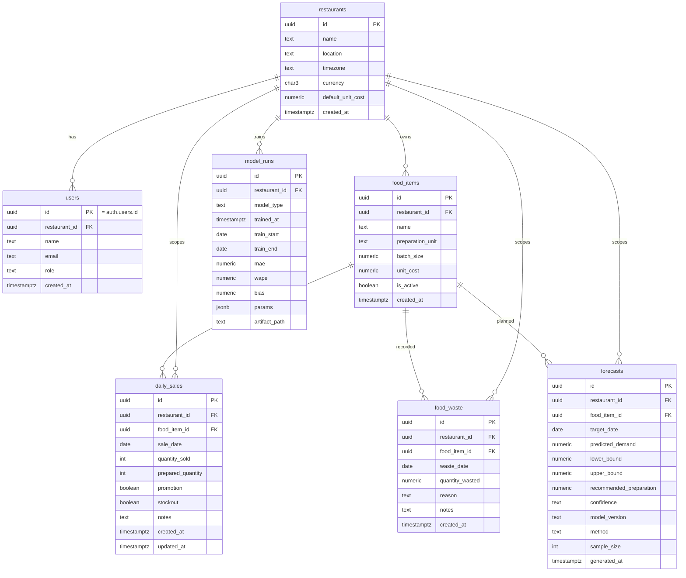

# FoodWasteOS — Database Schema

Canonical DDL: [supabase/schema.sql](../../supabase/schema.sql). ORM mirror:
[backend/app/db/models.py](../../backend/app/db/models.py). This document explains what is enforced
and why. Field semantics and derived metrics live in [08-data-model.md](08-data-model.md).

---

## 1. Principles

- **UUID primary keys** generated by the database (`gen_random_uuid()`; `pgcrypto` enabled).
- **Tenant column on every business table** (`restaurant_id`), denormalised onto facts so tenant
  queries never need a join to filter.
- **Natural-key uniqueness** makes every write idempotent: a retry updates instead of duplicating.
- **Check constraints for enumerations and non-negativity**, not application-only validation.
- **Cascading deletes** from `restaurants` and `food_items` so tenant removal is clean.
- **UTC timestamps** (`timestamptz`); business dates remain plain `date`.
- **Money as `numeric`**, never floats in storage.

---

## 2. Entity relationship diagram



---

## 3. Tables

### 3.1 `restaurants` — tenant root

| Column | Type | Constraints |
|---|---|---|
| `id` | uuid | PK, default `gen_random_uuid()` |
| `name` | text | not null |
| `location` | text | nullable |
| `timezone` | text | not null, default `Asia/Kolkata` |
| `currency` | char(3) | not null, default `INR` |
| `default_unit_cost` | numeric(10,2) | nullable, `>= 0` |
| `created_at` | timestamptz | not null, default `now()` |

`timezone` drives "today"/"tomorrow" resolution; `default_unit_cost` is the fallback for dishes
without a cost.

### 3.2 `users` — profile mirroring Supabase Auth

| Column | Type | Constraints |
|---|---|---|
| `id` | uuid | PK — equals `auth.users.id` (no DB default in DDL) |
| `restaurant_id` | uuid | FK → restaurants, `ON DELETE CASCADE`, indexed |
| `name` | text | nullable |
| `email` | text | not null |
| `role` | text | not null, default `owner`, check in (`owner`,`manager`,`staff`) |
| `created_at` | timestamptz | not null, default `now()` |

The API never creates users in Supabase mode; a valid JWT whose `sub` has no profile gets 403.
The ORM adds a uuid default so demo/test users can be created without Supabase.

### 3.3 `food_items` — dish catalogue

| Column | Type | Constraints |
|---|---|---|
| `id` | uuid | PK |
| `restaurant_id` | uuid | FK → restaurants, CASCADE, indexed |
| `name` | text | not null |
| `preparation_unit` | text | not null, default `plate` |
| `batch_size` | numeric(8,2) | not null, default 1, `> 0` |
| `unit_cost` | numeric(10,2) | nullable, `>= 0` |
| `is_active` | boolean | not null, default true |
| `created_at` | timestamptz | not null, default `now()` |

`UNIQUE (restaurant_id, name)` — names are unique per tenant, not globally.
`batch_size` converts a statistical quantity into an executable one (round up to the batch).
`unit_cost` is optional so onboarding never blocks on cost data.

### 3.4 `daily_sales` — one row per dish per day

| Column | Type | Constraints |
|---|---|---|
| `id` | uuid | PK |
| `restaurant_id` | uuid | FK → restaurants, CASCADE |
| `food_item_id` | uuid | FK → food_items, CASCADE |
| `sale_date` | date | not null |
| `quantity_sold` | integer | not null, default 0, `>= 0` |
| `prepared_quantity` | integer | nullable, `>= 0` |
| `promotion` | boolean | not null, default false |
| `stockout` | boolean | not null, default false |
| `notes` | text | nullable |
| `created_at` | timestamptz | not null, default `now()` |
| `updated_at` | timestamptz | not null, default `now()` |

- `UNIQUE (food_item_id, sale_date)` — the idempotency key; re-uploads upsert.
- Indexes: `(restaurant_id, sale_date)` for tenant range scans, `(food_item_id, sale_date)` for
  per-dish history.
- `stockout` is semantically "the dish sold out", not "zero sold"; it signals censored demand.
- `updated_at` is maintained by SQLAlchemy `onupdate`; there is no DB trigger, so raw SQL updates
  must set it explicitly.

### 3.5 `food_waste` — waste events

| Column | Type | Constraints |
|---|---|---|
| `id` | uuid | PK |
| `restaurant_id` | uuid | FK → restaurants, CASCADE |
| `food_item_id` | uuid | FK → food_items, CASCADE |
| `waste_date` | date | not null |
| `quantity_wasted` | numeric(8,2) | not null, `> 0` |
| `reason` | text | not null, check in (`overproduction`,`unsold`,`spoilage`,`expired`,`other`) |
| `notes` | text | nullable |
| `created_at` | timestamptz | not null, default `now()` |

`UNIQUE (food_item_id, waste_date, reason)` lets waste be recorded in parts (e.g. 2 spoilage + 3
unsold on the same day) while keeping each reason idempotent. Index `(restaurant_id, waste_date)`.

### 3.6 `forecasts` — materialised preparation plan

| Column | Type | Constraints |
|---|---|---|
| `id` | uuid | PK |
| `restaurant_id` | uuid | FK → restaurants, CASCADE |
| `food_item_id` | uuid | FK → food_items, CASCADE |
| `target_date` | date | not null |
| `predicted_demand` | numeric(10,2) | not null, `>= 0` |
| `lower_bound` | numeric(10,2) | nullable |
| `upper_bound` | numeric(10,2) | nullable |
| `recommended_preparation` | numeric(10,2) | not null, `>= 0` |
| `confidence` | text | not null, check in (`high`,`medium`,`low`) |
| `model_version` | text | not null |
| `method` | text | not null |
| `sample_size` | integer | not null, default 0 |
| `generated_at` | timestamptz | not null, default `now()` |

- `UNIQUE (food_item_id, target_date)` — one plan line per dish per day; regeneration updates.
- `CHECK (lower_bound IS NULL OR upper_bound IS NULL OR lower_bound <= upper_bound)`.
- Index `(restaurant_id, target_date)` for the planner and accuracy joins.
- Why materialise: the morning plan must be stable, auditable and fast; recomputation is explicit.
- `method` and `model_version` both currently hold `weekday_average_v1`; the duplication is a
  placeholder for a future separate engine version.

### 3.7 `model_runs` — model audit trail

| Column | Type | Notes |
|---|---|---|
| `id` | uuid | PK |
| `restaurant_id` | uuid | FK → restaurants, CASCADE |
| `model_type` | text | e.g. `weekday_average_v1`, `rf_v1` |
| `trained_at` | timestamptz | default `now()` |
| `train_start`, `train_end` | date | nullable window |
| `mae` | numeric(10,3) | nullable |
| `wape` | numeric(8,4) | nullable |
| `bias` | numeric(10,3) | nullable |
| `params` | jsonb | not null, default `'{}'` |
| `artifact_path` | text | nullable |

Append-only by intent: one row per plan generation. `services/model_runs.record_run` inserts the row
in the same transaction as the forecast rows, with the training window, params and recent
MAE/WAPE/bias when scored forecasts exist. Indexed by `(restaurant_id, trained_at desc)`.

> Dialect note: the DDL uses `jsonb`; the ORM maps `JSON` with a `JSONB` variant for Postgres, so
> `create_all` and the canonical DDL agree. `trained_at` is set with microsecond precision by the
> service so successive runs remain orderable.

---

## 4. Relationships and delete behaviour

```
restaurants 1 ── * users
            1 ── * food_items 1 ── * daily_sales
                                1 ── * food_waste
                                1 ── * forecasts
            1 ── * model_runs
```

- Deleting a restaurant cascades to every child row.
- Deleting a dish cascades to its sales, waste and forecasts.
- There is no soft delete for facts; dishes use `is_active=false` to leave the plan while keeping
  history.
- `daily_sales.restaurant_id` and `food_waste.restaurant_id` are denormalised on purpose: filtering
  by tenant is a single indexed predicate, and a wrong join cannot silently widen scope.

---

## 5. Indexes

| Index | Purpose |
|---|---|
| `users_restaurant_idx` | list users for a tenant |
| `food_items_restaurant_idx` | catalogue queries |
| `daily_sales_restaurant_date_idx` | dashboard/analytics date ranges |
| `daily_sales_item_date_idx` | per-dish history for forecasting |
| `food_waste_restaurant_date_idx` | waste ranges and trends |
| `model_runs_restaurant_idx` | latest runs per tenant |
| `forecasts_restaurant_date_idx` | planner and accuracy lookups |
| Implicit unique indexes | `(restaurant_id,name)`, `(food_item_id,sale_date)`, `(food_item_id,waste_date,reason)`, `(food_item_id,target_date)` |

At MVP scale (≤30 dishes, ≤180 days) these are sufficient; no partitioning.

---

## 6. Multi-tenancy and row-level security

- **Primary enforcement is the API**: `get_restaurant` + `restaurant_id` filters in every query.
- The API connects with a role that bypasses RLS; RLS is documented as defence in depth for future
  direct client access. A commented example policy exists in `schema.sql`:

```sql
alter table daily_sales enable row level security;
create policy tenant_read on daily_sales for select
    using (restaurant_id = (auth.jwt() ->> 'restaurant_id')::uuid);
```

- If direct client access is ever enabled, add the `restaurant_id` claim to issued JWTs and policies
  for every table, then separate the API DB role.

---

## 7. Dialect differences (Postgres vs SQLite)

| Concern | Postgres (prod) | SQLite (tests/demo) |
|---|---|---|
| UUID defaults | `gen_random_uuid()` + pgcrypto | ORM-side `uuid.uuid4` |
| `jsonb` | native | stored as text via generic JSON |
| `timestamptz` | timezone-aware | stored as text/datetime by the driver |
| Schema creation | `supabase/schema.sql` | `Base.metadata.create_all` when `APP_ENV=development` |
| Concurrency | row-level; unique constraints arbitrate races | single-writer; `StaticPool` in tests |
| Case sensitivity | identifiers folded | naive string compare |

Use Postgres for anything involving real concurrency or date/timezone behaviour.

---

## 8. Migration policy

- `supabase/schema.sql` is the source of truth for v0 and is idempotent (`create table if not
  exists`, `create index if not exists`, `create extension if not exists`).
- Docker Compose mounts it as the database's first init script.
- No Alembic. Introduce it at the first pilot schema change; the ORM already uses a stable naming
  convention (`pk_`, `fk_`, `uq_`, `ck_`, `ix_`) to keep generated migration names predictable.
- Changes must be additive first (add nullable column → backfill → enforce), because deploys and
  schema application are not coordinated.

---

## 9. Seed data

`SEED_DEMO_DATA=true` with `APP_ENV=development` creates:

- Restaurant **Spice Route Kitchen**, Navi Mumbai, `Asia/Kolkata`, INR, default cost 90.
- User `demo@foodwasteos.local`, role owner.
- 8 dishes: Chicken Biryani, Paneer Tikka, Veg Pulao, Butter Chicken, Dal Khichdi, Masala Dosa,
  Chole Bhature, Gulab Jamun — with batch sizes (5,4,5,5,5,2,4,10) and unit costs.
- 77 days (offsets 76…0) of sales per dish with weekday factors, 7% promotions, deliberate
  over-preparation (12–28%) and matching `unsold` waste rows.

Seeding is idempotent: if the restaurant already has any dish, it returns without inserting. It
never runs outside development (lifespan is gated on `APP_ENV`), and tests force it off.

---

## 10. Common query shapes

```sql
-- per-dish history for forecasting (tenant-scoped, date-bounded)
select food_item_id, sale_date, quantity_sold, promotion, stockout
from daily_sales
where restaurant_id = $1 and sale_date < $2
  and sale_date >= $2 - interval '180 days';

-- served plan
select * from forecasts
where restaurant_id = $1 and target_date = $2;

-- accuracy join
select f.*, s.quantity_sold
from forecasts f
join daily_sales s
  on s.food_item_id = f.food_item_id
 and s.sale_date = f.target_date
where f.restaurant_id = $1
  and f.target_date >= $2 and f.target_date < $3;
```

All three are supported by the indexes above.
