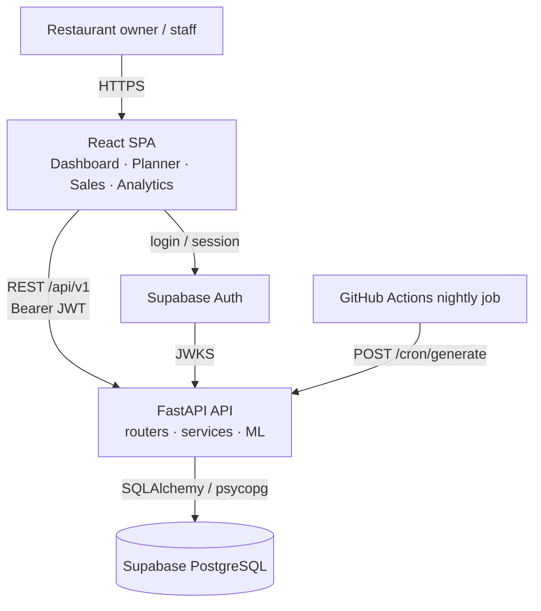
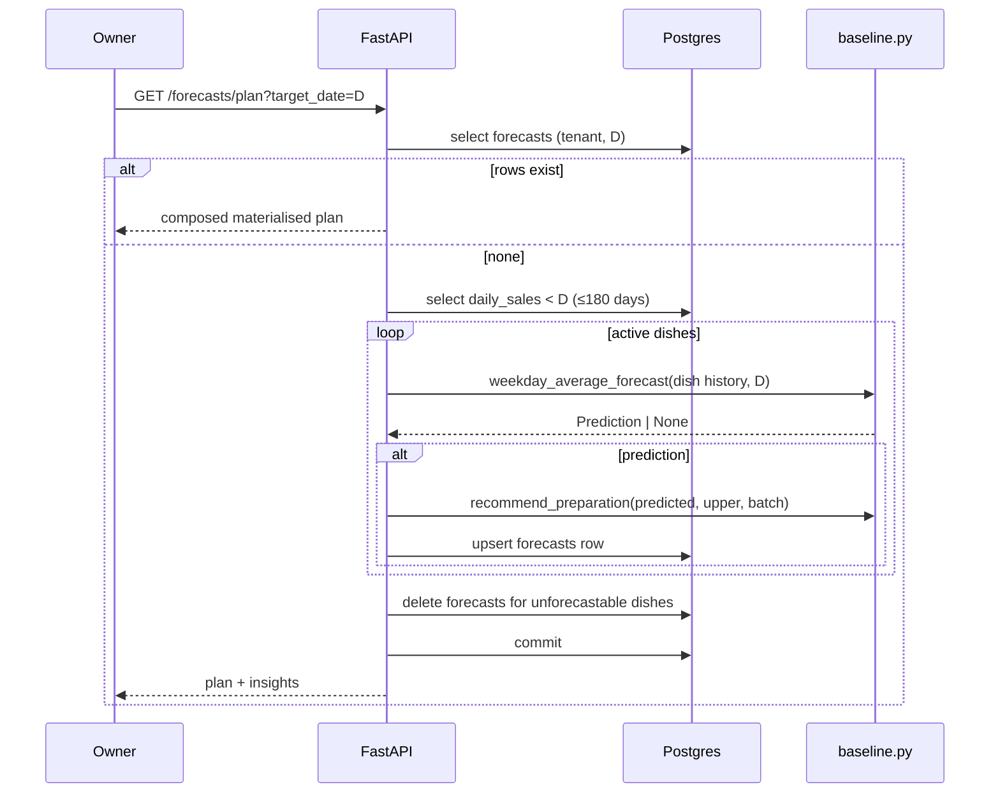

# FoodWasteOS — Architecture

System-level view: boundaries, decisions, request flows, the forecasting engine, security and
operations. Detailed contracts are in [05-backend-structure.md](05-backend-structure.md),
[06-database-schema.md](06-database-schema.md) and [04-frontend-guidelines.md](04-frontend-guidelines.md).

---

## 1. System context



One SPA, one API deployable, one Postgres, one auth provider. Forecasting runs **inside** the API
process; per-tenant training and inference are sub-second at 10–30 dishes.

---

## 2. Containers and responsibilities

| Container | Owns | Does not own |
|---|---|---|
| React SPA | Routing, session presentation, server-state cache, all UX copy | Business rules, tenant scoping, forecasting |
| FastAPI API | Auth verification, tenant scope, validation, business rules, ML, persistence | UI state, HTML rendering |
| Supabase Auth | Credentials, sessions, JWT issuance | App profile/roles (mirrored in `users`) |
| Supabase Postgres | Durable facts, plan cache, audit tables | Business logic |
| GitHub Actions cron | Triggering nightly plan generation | Recomputation logic (reuses the API) |

### Internal layering

```
api/v1  →  services  →  (ml | db)
```

- Routers: validation + identity + one service call. No SQL, no pandas.
- Services: use cases and transactions. No HTTP response models.
- ML: pure DataFrame functions/classes. No DB, no HTTP.
- DB models: persistence only.

This boundary lets `services/` and `ml/` move to a worker later without rewrites.

---

## 3. Architecture decisions

| # | Decision | Rationale | Revisit when |
|---|---|---|---|
| D1 | Modular monolith (FastAPI + SPA) | One team, one deploy target, shared transactions; ML is in-process | >100 tenants or >2 min forecast jobs |
| D2 | Synchronous SQLAlchemy 2.0 + psycopg | Simple, debuggable; FastAPI runs sync routes in a threadpool | Forecast jobs need isolation → worker |
| D3 | Supabase for Postgres + Auth | Managed backups, JWT, future social login; direct DB connection from the API | Self-hosting or cost limits |
| D4 | Forecasts are materialised | Planner loads instantly and shows a stable, auditable plan; recomputation is explicit | Real-time re-forecasting |
| D5 | Baseline first, RF later | Weekday average is strong and explainable with 2–4 weeks of data | Baseline proven on pilot data |
| D6 | Tenant isolation in the data-access layer | Defense in depth without requiring RLS on day one | Direct client DB access |
| D7 | Idempotent writes (natural unique keys + upsert) | Staff re-upload CSVs and retry; duplicates are unacceptable | — |
| D8 | Demand ≠ sales is modelled explicitly (`stockout`, `prepared_quantity`) | Sold-out days understate demand and bias forecasts downward | Full censored-demand model |
| D9 | No background queue | 30 dishes × 90 days is milliseconds; cron + request-time generation suffices | >5 tenants training concurrently |
| D10 | Money is optional per dish | Cost data would block onboarding; analytics degrades to quantities | — |
| D11 | Demo mode is explicit | Local evaluation without Supabase; visible banner; refused in prod | — |
| D12 | No random train/test splits | Random splits leak the future; walk-forward only | — |

---

## 4. Core request flow — plan generation



Properties:

- Deterministic per `(dish, target_date)` and idempotent on re-run.
- History strictly before the target date; no leakage.
- No forecast row for < 7 observations; the plan lists the dish as collecting data.
- Serving an existing plan does not rewrite it (except the initial materialisation).

---

## 5. Forecasting subsystem

### 5.1 Data contract

Training grain: one row per `(food_item_id, sale_date)` with target `quantity_sold`.

| History per dish | Behaviour |
|---|---|
| < 7 observations | No forecast; planner shows `collecting_data (n/7)` |
| 7–27 observations | Weekday average; confidence capped by the n ≥ 14 rule |
| ≥ 28 observations | Weekday average + residual bands; RF eligible (offline evaluation only) |

Missing days are tolerated by the baseline but shift lag semantics in the RF feature builder
(lags refer to the previous *observed* day). Normalise the series before serious backtesting.

### 5.2 Baseline (shipped)

`METHOD = "weekday_average_v1"` in [backend/app/ml/baseline.py](../../backend/app/ml/baseline.py).

```
for target weekday d:
  obs      = last up to 8 observations of weekday d
  predicted = exponentially weighted mean(obs), decay 0.9 (most recent heaviest)
  spread   = std(obs, ddof=1) if ≥2 else pooled within-weekday dispersion
  lower    = max(0, predicted - z(service_level) · spread)
  upper    = predicted + z(service_level) · spread
  recommended = ceil( min(max(upper, predicted), 1.25·predicted) / batch ) · batch
```

- `z(0.85) ≈ 1.036`; the band is derived from measured dispersion, not a fixed percentage.
- If no same-weekday observations exist but there is enough history, it falls back to the mean of the
  most recent 14 observations.
- If dispersion is zero, dispersion is pooled across weekdays so a single-observation weekday still
  gets a band.
- Recommendation lower clamp is the point forecast (never recommend below predicted), upper clamp is
  1.25× predicted. (The older architecture note mentions a 0.90× lower clamp; the code does not.)
- `predicted <= 0` → recommendation 0.

### 5.3 Confidence

Computed per dish from total observations in the lookback and the coefficient of variation
`cv = spread / predicted`:

| Label | Rule |
|---|---|
| high | `n ≥ 14` and `cv ≤ 0.12` |
| medium | `n ≥ 14` and `cv ≤ 0.25` |
| low | fewer observations, `cv > 0.25`, `predicted ≤ 0`, or any `stockout` in the last 14 observations |

Confidence is a UI commitment: *low* means "treat this as a starting point", and the planner says why.

### 5.4 Random Forest challenger (experimental)

[backend/app/ml/rf.py](../../backend/app/ml/rf.py): `RandomForestRegressor` (300 trees default,
`min_samples_leaf=2`, seed 42) over [features.py](../../backend/app/ml/features.py):

| Group | Features |
|---|---|
| Lags | `lag_1`, `lag_7`, `lag_14`, `lag_28` |
| Rolling | mean/std over 7 and 28 days, all shifted by 1 |
| Calendar | weekday, is-weekend, month, days since start |
| Events | promotion, stockout |
| Item | one-hot `food_item_id` (shared per-tenant model) |

Every rolling window is shifted before aggregation, so a row for day *t* never contains day *t*.
Requires ≥20 complete supervised rows. It is **not** wired into `generate_plan`; production always
uses the baseline. It exists for offline comparison and is covered by tests.

### 5.5 Backtesting

[evaluate.py](../../backend/app/ml/evaluate.py):

- `walk_forward(history, test_start, test_end)` trains on `< current` and predicts `current`, rolling
  one day at a time (rolling-origin). Never a random split.
- Metrics: MAE, WAPE (`Σ|error| / Σactual`), bias (`mean(predicted − actual)`), and the share of
  actuals inside the predicted band.
- Promotion guardrail (documented, not automated): RF must beat the baseline by ≥5% WAPE on ≥2
  consecutive windows for that tenant.

### 5.6 Serving, failure and stale handling

- Inference is in-process, per-tenant, target p95 < 2 s including DB reads.
- Plan is persisted; `generated_at` is shown; `stale` is true after `PLAN_STALE_HOURS` (default 36).
- If tomorrow's plan fails inside `/dashboard`, the exception is logged and the dashboard renders
  without the tomorrow card (never fabricates a plan).
- If generation fails on `/forecasts/plan`, the API returns an error; the planner shows a dedicated
  failure state with a retry.
- Regeneration (`POST /forecasts/generate`, owner/manager) updates rows in place. A nightly GitHub
  Actions job calls `POST /cron/generate` with `X-Cron-Secret` to materialise plans for every tenant.

### 5.7 Evaluation in the product

`/forecasts/accuracy` joins stored forecasts to actual sales for their target dates and computes the
same metrics over a window (default 28 days, 7–180). Stockout days are counted separately. This is
the feedback loop the product promise depends on.

---

## 6. Security and multi-tenancy

| Layer | Control |
|---|---|
| Transport | HTTPS at the edge (Vercel/Render) |
| Authentication | Supabase JWT; JWKS ES256/RS256 or legacy HS256; `aud` and `exp` verified |
| Identity mapping | `users.id = JWT sub`; unprovisioned → 403 |
| Tenant scope | `get_restaurant` + `restaurant_id` predicate on every query |
| Object ownership | Writes verify `food_item_id` belongs to the tenant (404 otherwise) |
| Roles | `require_role("owner","manager")` on catalogue, import, generation |
| Scheduled jobs | `X-Cron-Secret` constant-time compare; no human JWT accepted |
| Input limits | CSV 5 MB, Pydantic bounds on quantities/costs, enums for reason/role/confidence |
| Secrets | Environment only; `.env` is gitignored; dev auth rejected in staging/prod |
| RLS | Documented + commented policies; API role bypasses RLS by design today |
| CORS | Explicit allow-list from `ALLOWED_ORIGINS` |

Known residual risks:

- No rate limiting at the app layer (rely on the platform).
- Login page shows raw Supabase error messages (acceptable, but avoid leaking account existence).
- No audit log for who changed which fact (only `updated_at` on sales).
- No CSRF concern: bearer tokens are not cookies.

---

## 7. Deployment

| Component | Host | Configuration |
|---|---|---|
| SPA | Vercel | `npm run build` → `dist/`; `VITE_API_URL`, `VITE_SUPABASE_URL`, `VITE_SUPABASE_ANON_KEY` |
| API | Render (Docker, `backend/Dockerfile`) | `DATABASE_URL`, Supabase JWT settings, `ALLOWED_ORIGINS`, `APP_ENV=production`, `AUTH_MODE=supabase` |
| DB / Auth | Supabase | Apply `supabase/schema.sql`; daily backups; session pooler if serverless |
| Nightly job | GitHub Actions → `POST /api/v1/cron/generate` | `API_URL` + `CRON_SECRET` repository secrets |
| Local | Docker Compose | Postgres 16 + API + Vite dev server |

Deploy order: apply schema → deploy API → smoke `/health` and `/docs` → deploy SPA → verify login and
plan generation. Rollback: redeploy the previous API image; schema changes must remain
backward-compatible.

---

## 8. Observability

| Signal | Mechanism |
|---|---|
| Liveness/readiness | `GET /health` (DB `select 1`, 503 on failure) |
| Request logs | Uvicorn access logs (no structured request IDs yet) |
| Forecast generation | Log line `forecast.generated restaurant=… date=… items=…` |
| Dashboard degradation | Exception logged when tomorrow's plan fails |
| Model audit | `model_runs` row written per generation (window, params, recent accuracy) |
| Scheduled job | GitHub Actions run log; job fails when a tenant reports an error |
| Import quality | Import report returned to the client; not persisted |
| Client errors | API details shown in `ErrorNotice`; 401 clears the session |

Alerts to add with the pilot: 5xx rate, `/health` failures, forecast job absence, import error rate.

---

## 9. Scaling path

| Trigger | Change |
|---|---|
| >50 tenants or >5 min nightly job | Extract `ml` into a worker; queue per-restaurant jobs (RQ/Celery + Redis) |
| POS integrations | Ingestion service + per-source adapters + idempotency keys |
| Direct client DB access | Enable RLS, separate API DB role, add tenant claim to JWTs |
| Multiple outlets per brand | `outlets` table between restaurants and items; plans per outlet |
| High write volume | Partition `daily_sales` by month; retention policy for raw imports |
| Model per cuisine/cluster | Shared feature store + global model with item embeddings |
| Multi-instance API | Move artifacts to Supabase Storage; stop relying on local disk |

The current boundaries are chosen so these changes are additive rather than rewrites.

---

## 10. Deferred / unwired by design (be explicit with stakeholders)

| Item | State |
|---|---|
| Random Forest as default | Code + tests only; not selected per tenant |
| Model artifacts (`ML_ARTIFACT_DIR`, `registry.py`) | Helpers exist, no callers |
| Notifications/digest | Not started |
| Billing | Not started |
| RLS enforcement | Commented example only |
| Prepared-based waste rate | Explicitly out of scope; pilot uses `sales + waste` (P1.4) |
