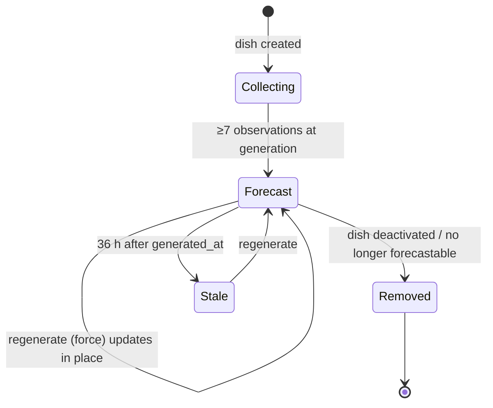

# FoodWasteOS — Data Model

What each entity means, which invariants hold, and exactly how every displayed number is derived.
Physical DDL is in [06-database-schema.md](06-database-schema.md); the ORM is
[backend/app/db/models.py](../../backend/app/db/models.py).

---

## 1. Conceptual model

```
Tenant (restaurant)
 ├── Users (owner / manager / staff)
 ├── Dishes (food_items)
 │    ├── Daily sales   (one row per dish per day)
 │    ├── Waste events  (one row per dish/day/reason)
 │    └── Forecasts     (one row per dish per target date)
 └── Model runs         (one row per generation)
```

Two facts (`daily_sales`, `food_waste`) feed one derived artifact (`forecasts`). `model_runs` is the
intended audit trail.

### Grain

| Entity | Grain | Natural key |
|---|---|---|
| `restaurants` | tenant | `id` |
| `users` | person per tenant | `id` (= Supabase `sub`) |
| `food_items` | dish per tenant | `(restaurant_id, name)` |
| `daily_sales` | dish × calendar day | `(food_item_id, sale_date)` |
| `food_waste` | dish × day × reason | `(food_item_id, waste_date, reason)` |
| `forecasts` | dish × target day | `(food_item_id, target_date)` |
| `model_runs` | one training run | `id` (append-only) |

Note: sales are per dish-day, not per outlet. Multi-outlet support requires an `outlets` layer
between restaurants and items (deferred).

---

## 2. Invariants

1. **Tenant ownership.** A dish, sale, waste row or forecast belongs to exactly one restaurant; all
   queries filter by `restaurant_id`.
2. **Natural-key uniqueness.** Re-submitting the same dish/day (or dish/day/reason) updates the row.
3. **Non-negativity.** Sold, prepared and waste quantities, predicted demand and recommended prep
   are all ≥ 0. Waste quantity is strictly > 0.
4. **Demand is not sales.** A `stockout=true` day means sales were truncated by availability; the
   recorded number is a lower bound on demand.
5. **No fabricated forecasts.** If a dish has fewer than 7 observations, no `forecasts` row exists
   and the plan item is `collecting_data`.
6. **Recommendation ordering.** `0 ≤ predicted_demand ≤ recommended_preparation` and
   `recommended_preparation ≤ 1.25 × predicted_demand`, rounded up to batch size.
7. **Band ordering.** When both bounds exist, `lower_bound ≤ upper_bound`; `predicted_demand` lies
   inside the band by construction.
8. **Forecast history is strictly past.** Generation for date *d* reads only `sale_date < d`.
9. **One active plan per dish/day.** Regeneration updates the existing row rather than appending.
10. **Unknown cost is not zero.** Cost-derived fields are `null` when no cost is known.

---

## 3. Entity semantics

### `restaurants`

Configuration root: timezone (for "today"/"tomorrow"), currency (for display), default unit cost
(fallback when a dish has none). No business facts hang off it directly except through children.

### `users`

A profile, not a credential. Auth credentials live in Supabase. `id` must equal the JWT `sub`.
`role` gates mutations; it is not a tenant permission system.

### `food_items`

A dish the kitchen prepares. Fields that change planning:

| Field | Effect |
|---|---|
| `name` | Unique per tenant; joined into sales/plan output |
| `preparation_unit` | Display only (`plate`, `kg`, …) |
| `batch_size` | Rounds recommended prep up to an executable batch |
| `unit_cost` | Powers waste cost and savings; optional |
| `is_active` | Inactive dishes leave the plan; history retained |

### `daily_sales`

The training signal. One row answers: how many sold, how many were prepared, was there a promotion,
did we sell out.

- `quantity_sold` — units actually sold, ≥ 0. Zero is a valid observed demand (not missing).
- `prepared_quantity` — units cooked; nullable. Captured but **not yet used** in waste-rate math.
- `promotion` — promotional day; available to the RF feature builder, not used by the baseline.
- `stockout` — dish ran out. Caps confidence at low for the next forecast and signals censoring.
- `notes` — free text, capped at 500 chars by the API.

### `food_waste`

Waste is recorded in parts by reason. The unique key includes `reason`, so 3 unsold + 2 spoilage on
the same day are two rows that sum to 5. This supports later reason-level analytics without a schema
change.

### `forecasts`

A materialised decision record, not a cache of a pure function: it stores what the kitchen was told,
when, by which method, with what evidence. Fields:

| Field | Meaning |
|---|---|
| `predicted_demand` | Point forecast for the weekday |
| `lower_bound` / `upper_bound` | Service-level band from measured dispersion |
| `recommended_preparation` | Batch-rounded, clamped quantity to cook |
| `confidence` | `high`/`medium`/`low` from dispersion and sample size |
| `method` / `model_version` | `weekday_average_v1` today |
| `sample_size` | Observations used by the model |
| `generated_at` | When this row was last computed; drives `stale` |

### `model_runs`

Append-only training metadata (window, MAE/WAPE/bias, params, artifact path). One row is written per
plan generation together with the forecast rows; accuracy fields stay null until past forecasts have
actual sales to compare against.

---

## 4. Derived metrics — exact definitions as implemented

### 4.1 Waste rate

```python
denominator = sales_quantity + waste_quantity
waste_rate  = waste_quantity / denominator if denominator else 0.0
```

Computed over the selected window (dashboard: today; analytics: 1–365 days). Shown as a percentage.
Both endpoints call `services/analytics.waste_rate`, so the formula cannot drift.

> **Decision (P1.4, 2026-11-16).** The earlier spec defined `waste / prepared` when
> `prepared_quantity` is known. The pilot keeps `waste / (sales + waste)` because prepared entry is
> optional and a prepared-based rate would be missing or incomparable for many real days. The two
> are equivalent only when `prepared = sales + waste`. `prepared_quantity` remains stored for
> stockout interpretation and future analysis.

### 4.2 Estimated waste cost

For each waste row:

```python
unit_cost = dish.unit_cost if dish.unit_cost is not None else restaurant.default_unit_cost
row_cost  = quantity_wasted × unit_cost if unit_cost is not None else None
```

- Total cost = sum of rows with known cost.
- The API returns `null` when **no** row has a known cost (UI shows "—" and asks for costs).
- Partial coverage is returned as the sum of known rows; there is no separate coverage percentage.
- Top-wasted dishes return `cost: null` per dish when that dish has no cost.

### 4.3 Dashboard totals

| Field | Definition |
|---|---|
| `sales_quantity` | Σ sold today |
| `waste_quantity` | Σ wasted today (all reasons) |
| `waste_rate` | §4.1 over today |
| `estimated_waste_cost` | §4.2 over today |
| `series` | 14 days, each `{date, sold, wasted}` with zeros for missing days |
| `tomorrow.predicted_total` | Σ predicted demand over dishes with a forecast |
| `tomorrow.recommended_total` | Σ recommended prep over the same dishes |
| `tomorrow.vs_usual_pct` | `(predicted_total / usual − 1) × 100`, where `usual` is the restaurant-wide average total for the same weekday over the last 4 weeks (strictly before the target date); `null` when either side is unavailable |

### 4.4 Forecast accuracy

Window: `target_date ∈ [today − days, today)` (default 28, allowed 7–180). One comparison per
materialised forecast joined to the actual sale on that exact date.

```
error        = predicted − actual
MAE          = mean(|error|)
WAPE         = Σ|error| / Σactual          (0 when Σactual = 0)
bias         = mean(error)                  (positive → over-preparing)
within_band  = share of rows with both bounds whose actual ∈ [lower, upper]
evaluated_items = distinct dishes with at least one comparison
stockout_days   = distinct sale dates in the window with any stockout=true row
```

Rows are only counted where both a forecast and an actual sale exist. A forecast for a day with no
recorded sale does not count as perfect or wrong; it is simply not evaluated.

### 4.5 Cold start and observations

- `observations` on a plan item = count of all sales rows for that dish with `sale_date < target_date`
  (not limited to 180 days).
- `sample_size` = rows actually used by the forecaster (within the 180-day lookback).
- `< 7` observations → no forecast; `status = "collecting_data"`.
- `7–13` observations → forecast exists but confidence cannot reach medium/high.

### 4.6 Plan insights

Generated server-side from the composed plan:

- Demand vs typical same weekday (4-week total average): "in line" if |Δ| < 3%, else "X% above/below".
- "Prepare about N portions in total."
- "N dishes have low confidence — treat those numbers as a starting point."
- "N dishes need more sales history before they can be forecast."
- If none apply: "Import at least 7 days of sales per dish…".

---

## 5. Demand, sales and censoring

Sales are the only observed outcome, but the desired target is demand. Three cases:

| Situation | Recorded | Meaning |
|---|---|---|
| Normal day | sold < prepared | `quantity_sold` is demand |
| Over-produced | sold < prepared, leftovers | `quantity_sold` is demand; waste is recorded separately |
| Stockout | sold = prepared, `stockout=true` | `quantity_sold` is a lower bound; true demand is unknown |

The baseline does not correct for censoring in v0. It caps confidence at low when any stockout
appears in the dish's last 14 observations, so the owner is warned instead of being given a
confident low number. A censored-demand model is a post-pilot item.

`prepared_quantity` is the only way to distinguish a genuine zero-demand day from a day the kitchen
never cooked the dish. It is optional by design to keep entry fast; its absence limits waste-rate
accuracy, not forecasting (which uses sold quantities).

---

## 6. Time semantics

| Concept | Rule |
|---|---|
| Storage | `timestamptz` in UTC; business dates as `date` |
| "Today" / "tomorrow" | Resolved server-side with the restaurant's timezone (`local_today`) |
| History cutoff | Strictly `< target_date` |
| Lookback | `FORECAST_HISTORY_DAYS` (default 180) for generation |
| Stale plan | `now − generated_at > 36 h` |
| Default planner date | Tomorrow in restaurant timezone |
| Accuracy window | Ends *before* today (plans need an actual sale to compare) |
| Frontend dates | Local-date ISO strings (`YYYY-MM-DD`), sent explicitly to the API |

A forecast for a past date is still allowed; it simply uses history before that date. This makes
backfills and audits possible.

---

## 7. Lifecycle of a plan row



- `collecting_data` is not a stored forecast row; it is a computed plan item for active dishes with
  no row.
- Deactivating a dish removes its forecast rows only on the next **forced** regeneration (a normal
  read returns the stored plan as-is).
- Plan rows are never versioned; `generated_at` records the latest computation only.

---

## 8. Worked examples

### 8.1 Recommendation

History for a Saturday: predicted 85, residual spread 12, service level 0.85 → `z ≈ 1.036`.

```
upper = 85 + 1.036 × 12 = 97.43
target = min(max(97.43, 85), 1.25 × 85 = 106.25) = 97.43
batch = 5 → recommended = ceil(97.43 / 5) × 5 = 100
```

With a noisy spread (upper 200), the clamp wins: `target = 106.25 → 110`. With `predicted ≤ 0`,
recommended is 0.

### 8.2 Confidence

- `n = 40`, `cv = 12 / 85 = 0.141` → not high (cv > 0.12), medium (cv ≤ 0.25) → **medium**.
- `n = 10`, `cv = 0.05` → **low** (needs ≥14 observations).
- Any stockout in the last 14 observations → **low**, regardless of the above.

### 8.3 Waste cost

Dish cost 120, default cost 90. Waste rows: 4 units of a dish with cost 120, 2 units of a dish with
no cost.

```
known = 4 × 120 = 480
total = 480 (the 2 units fall back to 90 only if a restaurant default exists;
        if no default and no dish cost, they are excluded from cost, still counted in quantity)
```

### 8.4 Accuracy

Two forecasts: (pred 100, actual 90), (pred 80, actual 90).

```
MAE   = (10 + 10) / 2 = 10
WAPE  = 20 / 180 ≈ 0.111 → 11.1%
bias  = (10 − 10) / 2 = 0
```

---

## 9. Data quality rules

Enforced at ingestion:

| Rule | Where |
|---|---|
| Date parses to a real date | CSV import |
| Dish name non-empty | CSV import |
| Sold is a whole number ≥ 0 | CSV import + Pydantic |
| Prepared is a whole number ≥ 0 when present | CSV import + Pydantic |
| Waste quantity > 0 | Pydantic + DB check |
| Waste reason in the enum | Pydantic + DB check |
| Notes ≤ 500 chars | Pydantic |
| Duplicate rows in a file: last wins | CSV import |
| Unknown dishes auto-created (batch 1) | CSV import |
| File ≤ 5 MB | CSV import |
| Dish belongs to tenant | Upsert services (404 otherwise) |
| Duplicate dish name | Catalogue service + unique constraint (409) |

Not enforced (data-quality risks): missing calendar days, `prepared < sold`, multiple shifts per day
collapsed into one row, and stockout flags left false.

---

## 10. Known modelling gaps

1. No censored-demand correction; stockouts only reduce confidence.
2. No promotion or festival effect in the baseline.
3. RF predictions are not materialised or served.
4. Missing days shift RF lag semantics (lags target the previous observed day).
5. No substitution effects between dishes.
6. No outlet dimension.
